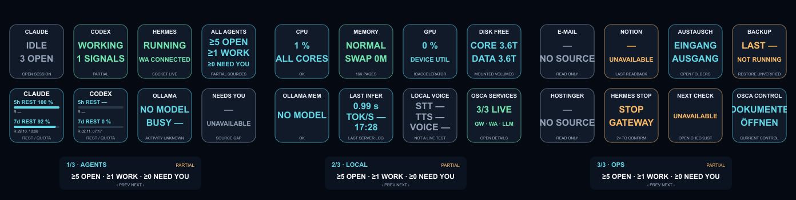

# OSCA Neo · Stream Deck Neo als Agenten- und Systemkonsole

Individueller Build `0.3.1-osca.1` auf Basis von [Neo Agent Deck](https://github.com/m-a-b-u/neo-agent-deck) v0.3.1 (`75afd9a`, MIT). Läuft auf dem Mac Studio **OSCA** und steuert ein Elgato Stream Deck Neo direkt über USB/HID. Die Elgato-App wird nicht benötigt.



## Seiten

Mit dem linken und rechten Touch Point wechseln Tasten und Infobar gemeinsam zwischen drei Seiten, mit Umlauf in beide Richtungen.

| Seite | Oben 1–4 | Unten 5–8 |
| --- | --- | --- |
| AGENTS | Claude, Codex, Hermes, All Agents | Claude-Rest, Codex-Rest, Ollama geladen, Needs You |
| LOCAL | CPU, Memory Pressure/Swap, GPU, DATA/CORE frei | Ollama-Modellspeicher, letzte Inferenz, lokale Sprache, OSCA-Dienste |
| OPS | E-Mail, Notion-Beleg, Austausch, Backup | Hostinger, Hermes Gateway stoppen, nächster Prüfpunkt, Control öffnen |

`PARTIAL`, `UNAVAILABLE` und `≥` kennzeichnen echte Lücken in den Quellen. Fehlende Werte werden nicht erfunden, und null erkannte Rückfragen werden nicht als „ALL CLEAR“ angezeigt. „Hermes Stop“ braucht zwei getrennte Drücke innerhalb von fünf Sekunden. Details zu Quellen, Grenzen und Abnahme stehen im [Bericht](docs/osca/BERICHT.md).

## Installation auf OSCA

| | Pfad |
| --- | --- |
| Quellcode (dieses Repo) | `/Volumes/OSCA-DATA/Projects/OSCA-Neo-2026-10-26/source`, Branch `osca` → `main` |
| Laufende Installation | `~/.local/share/neo-agent-deck` (gebauter Entry `dist/src/index.js`) |
| Konfiguration | `~/.neo-agent-deck/config.json`, Vorlage: [`deploy/osca/config.json`](deploy/osca/config.json) |
| Dienst | LaunchAgent `com.neo-agent-deck`, Vorlage: [`deploy/osca/com.neo-agent-deck.plist`](deploy/osca/com.neo-agent-deck.plist). Startet beim Login, `KeepAlive` startet ihn nach einem Absturz neu. |
| Logs | `~/Library/Logs/NeoAgentDeck.log` und `NeoAgentDeck.error.log` |
| Node | `~/.local/node/node` (22.13+ oder 24+) |

Die Konfiguration enthält keine Zugangsdaten. Die Claude-Kontingente werden zur Laufzeit über die vorhandene Claude-Code-Anmeldung abgefragt, die Codex-Kontingente über die vorhandene Codex-Anmeldung.

## Status abfragen

- **Am Gerät:** Seiten über die Touch Points wechseln.
- **Browser (nur lokal auf OSCA, nur lesend):** <http://127.0.0.1:9463>
  - Status als JSON: <http://127.0.0.1:9463/api/status>
  - Vorschau der drei Seiten: <http://127.0.0.1:9463/preview/0.png> bis `2.png`
- **Terminal:**

  ```sh
  node dist/scripts/osca-status.js
  ```

  Der Befehl liest nur den laufenden Dienst und öffnet keinen zweiten HID-Zugriff auf das Gerät.

Über HTTP gibt es keine Fernaktionen. Der private Unix-Socket (`~/.neo-agent-deck/osca-neo.sock`, 0600) erlaubt ausschließlich Seitennavigation.

## Entwicklung

Die Abhängigkeiten liegen als lokale Kopie in `node_modules` und wurden nicht aktualisiert.

```sh
node scripts/clean.mjs && node node_modules/typescript/bin/tsc -p tsconfig.json   # Build
node node_modules/typescript/bin/tsc -p tsconfig.test.json                        # Testcompiler
node node_modules/vitest/vitest.mjs run                                           # 95 Tests
```

Produktiver Entry: `src/index.ts` → `src/osca/app.ts`. Die ursprünglichen Upstream-Module bleiben für Kompatibilität und OpenCode erhalten, sind aber nicht der Seitencontroller. Die Upstream-Dokumentation liegt unter [README.upstream.md](README.upstream.md).

Einen neuen Build in die laufende Installation zu übernehmen und ihn wieder zurückzunehmen, läuft über die Skripte im Projektordner (`prepare-deploy.py`, `activate.py`, `rollback.py`). Diese gehören nicht zum Repo, siehe [Rückweg](docs/osca/RUECKWEG.md).

## Historie

- `main` / `osca`: aktueller OSCA-Build auf dem Mac Studio (ab Oktober 2026).
- `archive/macbook-pro`: der frühere Claude-Code-/Codex-Fork vom MacBook Pro (`neo-agent-deck-cc`). Er ist zusätzlich als Vorfahre in der Historie von `main` enthalten.
- `feature/neo-erweiterungen`: frühere Erweiterungen, unverändert.
- Remote `upstream`: [m-a-b-u/neo-agent-deck](https://github.com/m-a-b-u/neo-agent-deck).

## Lizenz

MIT, siehe [LICENSE](LICENSE). Originalprojekt von Manuel Burgschachner.
