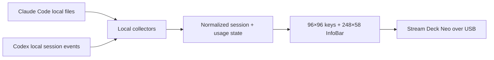

> **Independent fork:** This project started from [m-a-b-u/neo-agent-deck](https://github.com/m-a-b-u/neo-agent-deck) and is now an intentionally diverged, independently maintained edition. Regular upstream merges are not planned.

<p align="center">
  
</p>

<h1 align="center">Agent Stream Deck Neo Claude Code &amp; Codex</h1>

<p align="center">
  A local, glanceable Claude Code and Codex console for the Elgato Stream Deck Neo.<br>
  See active sessions, work that needs you, projects, and Codex rate limits directly on your desk.
</p>

<p align="center">
  <a href="https://github.com/mike-ai-de/agent-stream-deck-neo-claude-code-codex/actions/workflows/ci.yml"></a>
  <a href="LICENSE"></a>
  
  
</p>

The app turns the Neo's eight LCD keys, 248×58 InfoBar, and two touch points into one focused dashboard. It reads local agent state every three seconds, talks to the Stream Deck directly over USB, reconnects after unplugging, and keeps each collector isolated so one unavailable agent cannot stop the display.

## What you get

- Live Claude Code and Codex session states: **WORKING**, **NEED YOU**, or **IDLE**.
- Stable, ranked session keys that put waiting work before active and idle sessions.
- Project grouping by normalized working directory, including clear project labels.
- One-tap session focus on macOS when a process can be matched unambiguously.
- Local Codex rate-limit percentages and reset countdowns.
- An InfoBar that rotates through live sessions, Codex limits, and the combined agent view.
- Optional macOS notifications and sound when a session starts waiting.
- No telemetry, hosted backend, account system, or provider credential access.

## Default dashboard

```text
┌────────────┬────────────┬────────────┬────────────┐
│ Codex      │ Codex      │ Claude     │ All Agents │
│ status     │ usage      │ status     │ summary    │
├────────────┼────────────┼────────────┼────────────┤
│ Session 1  │ Session 2  │ Projects   │     ⓘ      │
│            │            │            │ InfoBar    │
└────────────┴────────────┴────────────┴────────────┘
        ◀ touch       248×58 InfoBar       touch ▶
```

| State | Meaning | Signal |
| --- | --- | --- |
| **WORKING** | At least one session is processing | Green |
| **NEED YOU** | A completed turn or blocked session awaits attention | Amber |
| **IDLE** | No active or unacknowledged session | Gray |

<p align="center">
  
</p>

The InfoBar rests on **Sessions** and cycles through **Sessions → Codex → All Agents**. Use the info key or right touch point to move forward and the left touch point to move backward.

<p align="center">
  
</p>

Every key has an action:

| Module | Tap action |
| --- | --- |
| `claude.status`, `codex.status` | Focus the primary matching session on macOS, then acknowledge waiting work |
| `codex.usage` | Open the configured HTTPS Codex analytics page on macOS |
| `session.1` … `session.4` | Focus that session when possible and acknowledge it |
| `projects` | Acknowledge all waiting sessions |
| `summary` | Show the All Agents InfoBar page |
| `info` | Advance the InfoBar one page |
| `blank` | Refresh local state |

## Install

Requirements: Git, Node.js 22.x or Node.js 24+, and macOS, Windows 10+, or Linux with a systemd user session. Node 23 is unsupported. The Neo may stay unplugged during setup.

```bash
git clone https://github.com/mike-ai-de/agent-stream-deck-neo-claude-code-codex.git
cd agent-stream-deck-neo-claude-code-codex
./install.sh                 # macOS or Linux
```

On Windows, run:

```powershell
.\install.cmd
```

The guided installer checks Node.js, installs dependencies, lets you confirm or customize the layout, builds a private per-user copy, and enables the matching login service. Close Elgato Stream Deck while this application owns the device; the macOS and Windows installers do that automatically.

Sign in to Claude Code or Codex locally before using its session view. A missing agent remains unavailable without blocking the other one.

See the full [setup guide](docs/SETUP.md) for WSL paths, service commands, every module, and troubleshooting.

## Data sources and privacy

| Agent | Local source | Network request by the collector |
| --- | --- | --- |
| Claude Code | Session metadata and project JSONL files under `~/.claude` | None |
| Codex | Session lifecycle and rate-limit events under `~/.codex` | None |

The collectors inspect lifecycle events, timestamps, working directories, and aggregate rate-limit values. They do not render prompts or responses. The application does not read, store, or transmit Claude or Codex credentials.

Claude subscription usage is deliberately **not collected**. The earlier implementation depended on an undocumented OAuth endpoint and access-token scope; this public fork removes that request path, token handling, and token setup tooling entirely. Claude session status and project labels remain local and fully supported.

Tapping the Codex usage key can ask the operating system to open the configured analytics page. The URL must be absolute HTTPS and defaults to `https://chatgpt.com/codex/cloud/settings/analytics`; set `codexUsageUrl` to `null` to disable it.

Default local data locations:

| Agent | Default | Override |
| --- | --- | --- |
| Claude Code | `~/.claude` | `CLAUDE_CONFIG_DIR` |
| Codex | `~/.codex` | `CODEX_HOME` |

## Configuration

Run the setup UI again at any time:

```bash
npm run setup
```

Configuration and acknowledgement state live in `~/.neo-agent-deck`; set `NEO_AGENT_DECK_HOME` to override that directory. The internal directory, service, and environment identifiers retain `neo-agent-deck` for compatibility with existing installations.

Useful commands:

```bash
npm run setup -- --print    # print the effective configuration
npm run setup -- --default  # restore the default layout
npm run status              # sanitized live collector summary; no Neo needed
npm run doctor              # platform, USB, data paths, and collectors
npm run preview:live        # render local live data without a Neo
```

Important behavior options in `~/.neo-agent-deck/config.json`:

| Key | Default | Effect |
| --- | --- | --- |
| `usageWarnPercent` | `80` | Codex usage turns amber at or above this percentage |
| `usageCriticalPercent` | `95` | Codex usage turns red at or above this percentage |
| `showProjectLabels` | `true` | Show the project directory instead of only a session count |
| `focusOnTap` | `true` | Focus an unambiguous matching session on macOS before acknowledging |
| `notifyOnAttention` | `true` | Send a macOS notification when a session starts waiting |
| `attentionSound` | `"Submarine"` | macOS system sound name, or `null` for silence |
| `codexUsageUrl` | Codex analytics page | HTTPS page opened from the Codex usage key, or `null` |

Invalid thresholds, sound names, pages, modules, and URLs fall back safely and cannot prevent startup.

## Platform support

| Capability | macOS | Windows | Linux |
| --- | :---: | :---: | :---: |
| Local session collection and rendering | ✓ | ✓ | ✓ |
| Per-user startup service | ✓ | ✓ | ✓ |
| Direct Stream Deck Neo USB control | ✓ | ✓ | ✓ |
| Window/session focus | ✓ | — | — |
| Browser opening, notifications, sound | ✓ | — | — |

On macOS, the first focus tap can trigger a one-time Automation consent dialog. Approve it under **System Settings → Privacy & Security → Automation**, then tap again. When multiple Codex processes share the same working directory, the app deliberately declines to guess which window to focus.

## How it works



Direct USB access uses the Neo HID implementation from the MIT-licensed `@elgato-stream-deck/node` library.

## Troubleshooting

- Run `npm run doctor`, followed by `npm run status` for a sanitized collector summary.
- Fully quit Elgato Stream Deck if its normal profile is still visible.
- On macOS, restart with `launchctl kickstart -k gui/$UID/com.neo-agent-deck`.
- On Windows, rerun `npm run install:win` to replace and restart the per-user copy.
- On Linux, use `systemctl --user restart neo-agent-deck.service`.
- Inspect `~/Library/Logs/NeoAgentDeck.error.log` on macOS, `~/.neo-agent-deck/logs/NeoAgentDeck.error.log` on Windows, or `journalctl --user -u neo-agent-deck.service` on Linux.

Never attach agent data directories, credentials, `~/.neo-agent-deck`, or SSH files to an issue.

## Development

```bash
npm ci
npm run check          # build, test typecheck, and 107 tests
npm run preview:docs   # regenerate README images with production renderers
npm run preview:live   # render current local agent data
npm run dev            # run in the foreground
```

CI covers macOS, Windows, and Linux with Node.js 22 and 24. Tagged releases run the same check before publishing. See [SECURITY.md](SECURITY.md) for private reporting guidance and [CHANGELOG.md](CHANGELOG.md) for release history.

## License and attribution

[MIT](LICENSE) © 2026 Manuel Burgschachner and © 2026 Mike ([mike-ai-de](https://github.com/mike-ai-de)). The original upstream work remains attributed in the license and at the top of this README.

Stream Deck is a trademark of Elgato/Corsair. Claude and Codex belong to their respective owners. This independent project is not endorsed by Elgato, Anthropic, or OpenAI.
