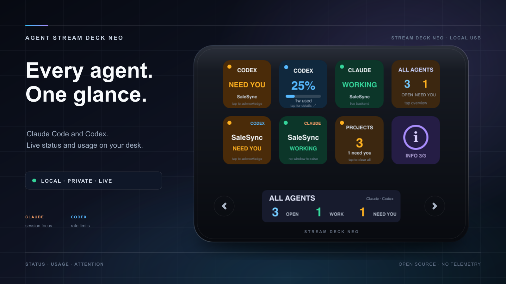
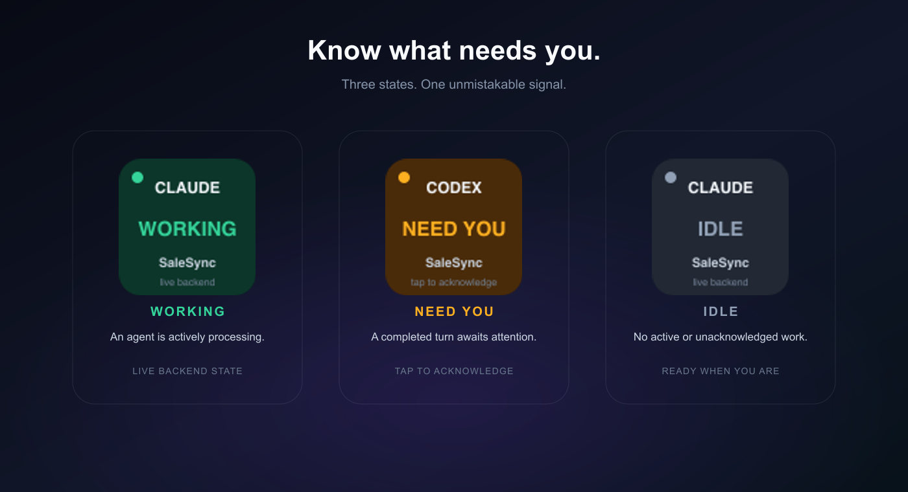
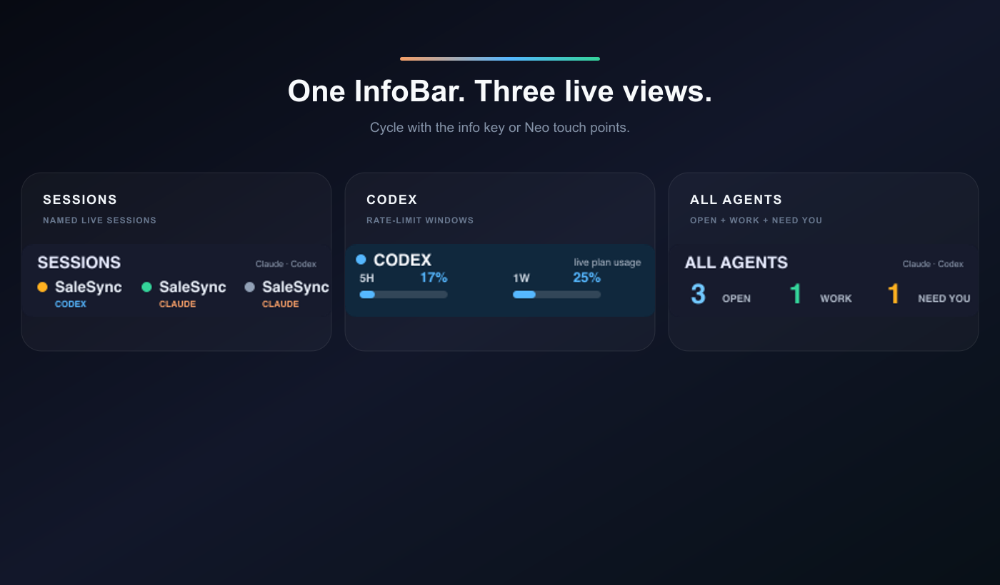
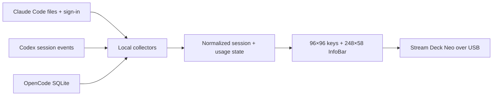

<p align="center">
  
</p>

<h1 align="center">Neo Agent Deck</h1>

<p align="center">
  A private, glanceable agent console for the Elgato Stream Deck Neo.<br>
  See Claude Code, Codex, and OpenCode status and usage directly on your desk.
</p>

<p align="center">
  <a href="https://github.com/m-a-b-u/neo-agent-deck/actions/workflows/ci.yml"></a>
  <a href="https://github.com/m-a-b-u/neo-agent-deck/releases/latest"></a>
  <a href="LICENSE"></a>
  
  
</p>

Neo Agent Deck turns the Neo's eight LCD keys, 248×58 InfoBar, and two touch points into one dashboard. It runs locally over USB, reconnects automatically, and safely waits when the device is unplugged.

## Install in three steps

Requirements: Git, [Node.js 22.13+ on Node 22 or Node.js 24+](https://nodejs.org/), and macOS, Windows 10+, or Linux with a systemd user session. Node 23 is unsupported. The Neo can stay unplugged during setup.

1. Clone the repository.

   ```bash
   git clone https://github.com/m-a-b-u/neo-agent-deck.git
   ```

2. Enter the project.

   ```bash
   cd neo-agent-deck
   ```

3. Start the guided installer.

   macOS / Linux:

   ```bash
   ./install.sh
   ```

   Windows PowerShell:

   ```powershell
   .\install.cmd
   ```

The terminal UI shows the recommended 4×2 layout first. Press Enter to accept it, or choose `y` to customize every key, InfoBar page, resting page, and brightness. The installer then builds a private per-user copy and enables automatic startup.

macOS and Windows need no administrator password. Linux asks for `sudo` only if HID runtime packages or its Stream Deck USB permission rule are missing; the application and service still run as your user.

Sign in to at least one supported agent locally. Providers that are not installed or signed in remain safely unavailable without blocking the others.

## The default dashboard

```text
┌────────────┬────────────┬────────────┬────────────┐
│ Claude     │ Codex      │ OpenCode   │ All Agents │
│ status     │ status     │ status     │ summary    │
├────────────┼────────────┼────────────┼────────────┤
│ Claude     │ Codex      │ OpenCode   │     ⓘ      │
│ usage      │ usage      │ usage      │ InfoBar    │
└────────────┴────────────┴────────────┴────────────┘
        ◀ touch       248×58 InfoBar       touch ▶
```

| State | Meaning | Signal |
| --- | --- | --- |
| **WORKING** | At least one session is processing | Green |
| **IDLE** | No active or unacknowledged session | Gray |
| **NEED YOU** | A turn completed, stopped, errored, or needs input | Amber |

<p align="center">
  
</p>

Tap an amber provider key to acknowledge completed sessions. Tap **All Agents** for the combined view. The info key and right touch point move forward through the InfoBar pages; the left touch point moves backward.

<p align="center">
  
</p>

The four pages show Claude's 5-hour and 7-day plan usage, Codex rate-limit windows, OpenCode local token totals, and combined session counts. If a refresh fails, retained values are marked **stale** instead of appearing live.

## Data sources and privacy

| Provider | Status and usage source | Network used by Neo Agent Deck |
| --- | --- | --- |
| Claude Code | Local session files; existing OAuth sign-in from macOS Keychain, the Claude credentials file, or `CLAUDE_CODE_OAUTH_TOKEN` | Anthropic usage request only |
| Codex | Lifecycle and rate-limit events in local Codex session files | None |
| OpenCode | Latest message plus aggregate token/cost fields in the local SQLite database | None |

Neo Agent Deck has no telemetry, hosted backend, or account system. It does not persist OAuth tokens or session content. Only lifecycle, timestamps, usage, and aggregate values affect the display. OpenCode uses Node's built-in read-only SQLite support; no separate `sqlite3` program is required.

Default data locations are home-relative on every platform:

| Provider | Default | Override |
| --- | --- | --- |
| Claude Code | `~/.claude` | `CLAUDE_CONFIG_DIR` |
| Codex | `~/.codex` | `CODEX_HOME` |
| OpenCode | `~/.local/share/opencode` | `OPENCODE_DATA_HOME` |

For the simplest Windows experience, run the agents natively on Windows. If their data lives in WSL, point the overrides at the corresponding `\\wsl.localhost\DISTRO\...` directories before installing the login service. See the [setup guide](docs/SETUP.md#windows-and-wsl) for an example.

## Configuration

The guided installer opens this setup automatically. To change keys, InfoBar rotation, resting page, or brightness later, run:

```bash
npm run setup
```

Configuration and acknowledgement state live in `~/.neo-agent-deck`. See the [setup guide](docs/SETUP.md) for every module and example layouts.

Useful non-interactive commands:

```bash
npm run setup -- --print    # show effective configuration
npm run setup -- --default  # restore the default layout
npm run status              # sanitized live backend summary; no Neo needed
npm run doctor              # platform, device, sign-in, files, DB, backends
npm run preview:live        # render live data and print the image path
npm run token:claude        # store a Claude OAuth token for usage reporting
```

### Behaviour options

These are not part of the guided wizard; edit `~/.neo-agent-deck/config.json` and restart the
service. Missing keys fall back to the defaults below, so an older config file keeps working.

| Key | Default | Effect |
| --- | --- | --- |
| `usageWarnPercent` | `80` | Usage key turns amber at or above this percentage. |
| `usageCriticalPercent` | `95` | Usage key turns red. Clamped up to `usageWarnPercent` if set lower. |
| `showProjectLabels` | `true` | Status keys name the session's project directory instead of a count. |
| `focusOnTap` | `true` | Tapping a key that needs attention raises the owning window, then acknowledges. |
| `notifyOnAttention` | `true` | Post a desktop notification when a session starts waiting. |
| `attentionSound` | `"Submarine"` | A name from `/System/Library/Sounds`, or `null` for silence. |

A usage key speaks for whichever window is closest to its limit, not the longest one: a 5-hour quota
at 99% must not hide behind a weekly quota at 30%. The countdown shows the soonest reset, which is
the same window the InfoBar names, so the two never disagree. While the collector is deliberately
holding off after a refusal, the key says `paused` rather than offering a refresh it will decline.

Usage keys and the InfoBar show the time remaining in the current quota window whenever the
backend reports a reset time. A stale reading keeps its provider colour rather than a warning
colour, so it is never mistaken for a live measurement.

`focusOnTap` raises Terminal.app and iTerm tabs by matching the session's tty, and falls back to
activating the application for other emulators. macOS asks for Automation permission the first
time; until it is granted the tap still acknowledges and the reason is written to the log.

### Session keys

`session.1` through `session.4` each stand for one concrete session rather than a provider total.
The list is ranked waiting first, then working, then idle, and by recency within each group.
Sessions that have finished are dropped, since a slot exists to be tapped. Ordering is not pinned —
the most urgent session should hold slot 1 even when that means a reshuffle — but equal timestamps
break on the session id so the order never depends on collector iteration order.

Each key shows the project directory name and the session state, and a tap raises that session's
window and acknowledges it. With several agents running in different repos, this answers "which one
needs me, and take me there" in one press. Only Claude Code sessions record a process to raise
today; a Codex or OpenCode session reads from a log file, so its key says `tap to acknowledge`
rather than promising a window it cannot bring forward.

These are useful in place of modules for a provider you do not run. The layout here, for a machine
with Claude Code and Codex but no OpenCode:

```json
"keys": ["claude.status", "codex.status", "session.1", "summary",
         "claude.usage",  "codex.usage",  "session.2", "info"],
"infoBar": ["claude", "codex", "all"]
```

The first tap that raises a window makes macOS show its one-time Automation consent dialog, and
`osascript` waits on that dialog rather than failing. The deck does not block on it — the
acknowledgement and the redraw happen immediately, and the outcome is written to the log. Approve
the dialog once and subsequent taps are instant.

### Claude usage needs a token with the `user:profile` scope

`claude setup-token` produces an inference-only token. The usage endpoint rejects it:

```
403 OAuth token does not meet scope requirement user:profile
```

A token with that scope comes from an interactive sign-in. Run `claude` in a terminal, sign in with
`/login`, then `npm run token:claude -- --clear` so the deck reads the Keychain rather than the
stored file. `npm run token:claude` checks a token against the endpoint while storing it, so this
shows up immediately rather than as a dashboard that quietly says "unavailable".

A missing scope is a property of the token and cannot resolve by waiting, so the collector parks
for four hours instead of retrying on the usual ladder. Storing a new token clears that wait for
the running service too — the deadline lives in a file every process re-reads, not only in the
memory of whichever one wrote it.

Everything else works without this: session status, project labels, Codex usage and its reset
countdown are all read locally.

### Claude usage when the Keychain entry is empty

A Claude Code install can hold a `Claude Code-credentials` Keychain entry whose `accessToken` is an
empty string. The sign-in works, but a separate process has nothing to present to the usage API and
`doctor` reports `Claude Code sign-in not available`. Generate a long-lived token and store it:

```bash
claude setup-token | npm run token:claude
```

Piping is the recommended route: the token goes straight from one process to the other and never
appears on screen or in shell history. The script scans the piped output for the token itself, so
the surrounding prose from `setup-token` does no harm.

Run `npm run token:claude` on its own to be prompted instead; the prompt reads the line without
echoing it. Either way the value must look like `sk-ant-…`, so a stray command pasted at the prompt
is rejected rather than stored.

The token is written to `~/.neo-agent-deck/claude-token` with mode `600` and is read after the
environment variable and the Keychain, so a healthy Keychain entry still wins. `npm run
token:claude -- --check` reports which source is in use, and `-- --clear` removes it.

A token printed to a terminal should be treated as exposed — it is in scrollback, and possibly in
shell history or a screen recording. Generate a fresh one with `claude setup-token` and pipe it.

## How it works



The app polls local agent state every three seconds. Claude plan usage is cached for five minutes unless you tap a usage key. Device disconnects, malformed session lines, missing backends, and temporary collector failures are isolated so the service keeps running and reconnects.

Direct USB access is intentional: Neo Agent Deck uses the Neo HID implementation from the MIT-licensed `@elgato-stream-deck/node` library.

## Troubleshooting

- **Elgato's normal profile is visible:** fully quit Elgato Stream Deck, then restart Neo Agent Deck.
- **A backend is unavailable:** run `npm run doctor`, then `npm run status` for the sanitized error.
- **The Neo is unplugged:** the service waits and reconnects automatically.
- **macOS restart:** `launchctl kickstart -k gui/$UID/com.neo-agent-deck`.
- **Windows restart:** run `npm run install:win` again; it replaces and restarts the per-user service.
- **Linux restart:** `systemctl --user restart neo-agent-deck.service`.
- **macOS logs:** `~/Library/Logs/NeoAgentDeck.log` and `NeoAgentDeck.error.log`.
- **Windows logs:** `~/.neo-agent-deck/logs/NeoAgentDeck.log` and `NeoAgentDeck.error.log`.
- **Linux logs:** `journalctl --user -u neo-agent-deck.service -f`.
- **Linux USB permission denied:** re-run `npm run install:linux`, then unplug and reconnect the Neo once.

To uninstall and return control to Elgato:

```bash
# macOS
npm run uninstall:mac
open -a "Elgato Stream Deck"
```

```powershell
# Windows
npm run uninstall:win
Start-Process "$env:ProgramFiles\Elgato\StreamDeck\StreamDeck.exe"
```

```bash
# Linux
npm run uninstall:linux
```

Preferences and logs are kept so reinstalling does not discard your layout.

## Development

```bash
npm ci
npm run doctor        # sanitized device and backend checks
npm run preview:live  # render current backend data without a Neo
npm run dev           # run in the foreground
npm run check          # build, test typecheck, and unit/integration tests
npm run preview:docs   # regenerate all README product images
```

On macOS or Windows, close Elgato Stream Deck before `npm run dev`; only one process can own the USB interface. CI checks macOS, Windows, and Linux with Node.js 22 and 24. Tagged releases are published only after the same cross-platform matrix and service-installer smoke tests pass.

## License

[MIT](LICENSE) © Manuel Burgschachner. Stream Deck is a trademark of Elgato/Corsair. Claude, Codex, and OpenCode belong to their respective owners. This independent project is not endorsed by Elgato, Anthropic, OpenAI, or the OpenCode maintainers.
