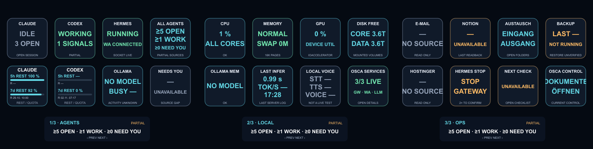

# OSCA Neo · Stream Deck Neo als Agenten- und Systemkonsole

Individueller Build `0.3.1-osca.1` auf Basis von [Neo Agent Deck](https://github.com/m-a-b-u/neo-agent-deck) v0.3.1 (`75afd9a`, MIT). Läuft auf dem Mac Studio **OSCA** und steuert ein Elgato Stream Deck Neo direkt über USB/HID. Die Elgato-App wird nicht benötigt.



## Seiten

Mit dem linken und rechten Touch Point wechseln Tasten und Infobar gemeinsam zwischen drei Seiten, mit Umlauf in beide Richtungen.

| Seite | Oben 1–4 | Unten 5–8 |
| --- | --- | --- |
| AGENTS | Claude, Codex, Hermes, All Agents | Claude-Rest, Codex-Rest, Ollama geladen, Needs You |
| LOCAL | CPU, Memory Pressure/Swap, GPU, DATA/CORE frei | Ollama-Modellspeicher, letzte Inferenz, lokale Sprache, OSCA-Dienste |
| OPS | E-Mail, Notion-Beleg, Austausch, Backup | Hostinger, Hermes Gateway stoppen, nächster Prüfpunkt, Control öffnen |

`PARTIAL`, `UNAVAILABLE` und `≥` kennzeichnen echte Lücken in den Quellen. Fehlende Werte werden nicht erfunden, und null erkannte Rückfragen werden nicht als „ALL CLEAR“ angezeigt. „Hermes Stop“ braucht zwei getrennte Drücke innerhalb von fünf Sekunden. Details zu Quellen, Grenzen und Abnahme stehen im [Bericht](docs/osca/BERICHT.md).

## Installation auf OSCA

| | Pfad |
| --- | --- |
| Quellcode (dieses Repo) | `/Volumes/OSCA-DATA/Projects/OSCA-Neo-2026-10-26/source`, Branch `osca` → `main` |
| Laufende Installation | `~/.local/share/neo-agent-deck` (gebauter Entry `dist/src/index.js`) |
| Konfiguration | `~/.neo-agent-deck/config.json`, Vorlage: [`deploy/osca/config.json`](deploy/osca/config.json) |
| Dienst | LaunchAgent `com.neo-agent-deck`, Vorlage: [`deploy/osca/com.neo-agent-deck.plist`](deploy/osca/com.neo-agent-deck.plist). Startet beim Login, `KeepAlive` startet ihn nach einem Absturz neu. |
| Logs | `~/Library/Logs/NeoAgentDeck.log` und `NeoAgentDeck.error.log` |
| Node | `~/.local/node/node` (22.13+ oder 24+) |

Die Konfiguration enthält keine Zugangsdaten. Die Claude-Kontingente werden zur Laufzeit über die vorhandene Claude-Code-Anmeldung abgefragt, die Codex-Kontingente über die vorhandene Codex-Anmeldung.

## Status abfragen

- **Am Gerät:** Seiten über die Touch Points wechseln.
- **Browser (nur lokal auf OSCA, nur lesend):** <http://127.0.0.1:9463>
  - Status als JSON: <http://127.0.0.1:9463/api/status>
  - Vorschau der drei Seiten: <http://127.0.0.1:9463/preview/0.png> bis `2.png`
- **Terminal:**

  ```sh
  node dist/scripts/osca-status.js
  ```

  Der Befehl liest nur den laufenden Dienst und öffnet keinen zweiten HID-Zugriff auf das Gerät.

Über HTTP gibt es keine Fernaktionen. Der private Unix-Socket (`~/.neo-agent-deck/osca-neo.sock`, 0600) erlaubt ausschließlich Seitennavigation.

## Cockpit fürs Handy (OSCA Flight Deck)

Unter `/cockpit` liefert der Handy-Dienst ein animiertes Glascockpit im Stil eines Flugzeugs, Kopfzeile „OSCA Flight Deck · Operating System · Core · Agent“:

- **Lampen:** Claude, Codex, Hermes und Orca·Pi leuchten grün, solange sie arbeiten; die LLM-Zeile zeigt das geladene Ollama-Modell und die Phase READING/WRITING.
- **Instrumente:** CPU und GPU (GPU ohne Warnbereich, Volllast ist gewollt), 18 CPU-Kerne als LED-Pegel mit Spitzenwert, Ausgabe-Token/s, Chip-Temperatur mit macOS-Hitzestufe, Swap.
- **Fuel:** Claude-Kontingent 5h/7d und Codex 7d als Tankanzeige mit Reset-Zeitpunkt.
- **EICAS:** Warnzeile für Temperatur, Swap/Speicherdruck, CPU-Last ab 90 %, knappe Kontingente und fehlende Quellen.
- **Flight Recorder:** Verlaufskurve unter jedem Instrument, live (1 Min.) oder 1 h / 24 h / 7 d / 30 d.
- **SYS:** alle bisherigen Neo-Werte kompakt; **NEO** führt zur alten Kachelseite (dort „‹ DECK“ zurück).

Datenquellen, alle nur lesend: das native Messprogramm `native/osca-sensors.swift` (CPU je Kern, GPU, Temperatursensoren, Hitzestufe, Swap; viermal pro Sekunde, ohne Administratorrechte; wird bei `npm run build` nach `dist/bin/osca-sensors` gebaut), das Ollama-Log (`slot print_timing` für Token/s und Phase), `orca terminal list --json` (Aktivität der letzten 15 s; Titel „Pi …“/„π …“ zählen als Pi) und `/api/status` des Neo-Dienstes. Die Seite bekommt die Werte per Server-Sent Events (`/api/cockpit/stream`, 4 Hz), Schnappschuss unter `/api/cockpit`. Keine Sitzungs-IDs, Pfade, PIDs oder Terminalinhalte.

Der Flight Recorder speichert einmal pro Sekunde CPU, GPU, Token/s, Chip-Temperatur und Swap in `/Volumes/OSCA-DATA/Projects/OSCA/Neo/data/cockpit-recorder.sqlite` (`OSCA_RECORDER_DB`, Aufbewahrung `OSCA_RECORDER_DAYS`, Standard 30 Tage, etwa 4 MB pro Tag). `/api/cockpit/history?range=1h|24h|7d|30d` liefert bis zu 240 gemittelte Punkte.

Als App: `https://osca.tail73d176.ts.net:9464/cockpit` in Safari öffnen, „Teilen → Zum Home-Bildschirm“. Dank Manifest startet sie im Vollbild ohne Adresszeile und heißt „OSCA“. Solange sie offen ist, hält sie den Bildschirm wach (Wake Lock).

**Widget (Scriptable):** `/widget` zeigt das fertige Skript mit Kopier-Button und Anleitung, `/widget.js` liefert es als Text, mit der Adresse des aufrufenden Hosts. Sperrbildschirm: rund (Parameter `temp`, `gpu`, `cpu` oder `tps`), rechteckig, einzeilig; Home-Bildschirm: klein, mittel, groß. Widgets sind Standbilder, die iOS etwa alle 5–15 Minuten erneuert; ein Tipp öffnet das Cockpit.

## Statusseite fürs Handy

Ein eigener, nur lesender Dienst (`scripts/osca-mobile.ts` → `src/osca/mobile.ts`) zeigt alle drei Seiten so, wie die Tasten am Neo aussehen: gleiche Texte, Farben und Kontingentbalken, dazu die Infobar. Er läuft getrennt vom HID-Dienst, liest dessen `/api/status` und gibt nur die Tasteninhalte weiter, keine Sitzungs-IDs, Pfade, PIDs oder Hashes. Die Seite aktualisiert sich alle fünf Sekunden. Zwischen AGENTS, LOCAL und OPS wechselst du per Wischen oder über die Reiter. Der Punkt am Reiter zeigt, welche Seite gerade am Gerät sichtbar ist. Fällt der Neo-Dienst aus oder ist das Gerät getrennt, zeigt die Seite das deutlich an.

Die Handyseite bietet pro Kachel einen lokalen Verlauf. Der Dienst speichert einmal pro Minute bereinigte Kachelinhalte und verfügbare Messwerte in `/Volumes/OSCA-DATA/Projects/OSCA/Neo/data/history.sqlite` (alternativ `OSCA_NEO_HISTORY_DB`). Die Speicherung beginnt mit der Aktivierung; vorhandene alte Protokolle werden nicht rückwirkend importiert. Einträge älter als 30 Tage werden automatisch gelöscht (`OSCA_HISTORY_DAYS`). Die Detailansicht ermöglicht das Löschen einzelner angezeigter Messpunkte oder der gesamten Historie einer Kachel nach Bestätigung. Andere Verläufe bleiben erhalten. Lücken oder unbekannte Werte sind keine Nullwerte; Inferenzwerte zeigen den zuletzt vom Neo gemeldeten Wert, nicht garantiert jede einzelne Anfrage. Bei gestopptem Handy- oder Neo-Dienst entstehen Lücken. Der Webdienst erlaubt zusätzlich ausschließlich für die eigene Verlaufshistorie geschützte Löschanfragen; Geräteaktionen bleiben über HTTP deaktiviert.

| | |
| --- | --- |
| Lokal | <http://127.0.0.1:9464>, Cockpit `/cockpit`, JSON: `/api/mobile`, `/api/cockpit` |
| Handy (Tailnet) | <https://osca.tail73d176.ts.net:9464/cockpit> (Cockpit), <https://osca.tail73d176.ts.net:9464> (Kachelseite) |
| Installation | `~/.local/share/osca-neo-mobile` (Kopie von `dist`, `node_modules` wie beim Neo-Dienst) |
| Dienst | LaunchAgent `de.osca.neo-mobile`, Vorlage: [`deploy/osca/de.osca.neo-mobile.plist`](deploy/osca/de.osca.neo-mobile.plist) |
| Logs | `~/Library/Logs/OSCANeoMobile.log` und `OSCANeoMobile.error.log` |

Der Dienst lauscht nur auf `127.0.0.1` und nimmt nur Anfragen an Loopback- oder `*.ts.net`-Hostnamen an. Erreichbar wird er vom Handy über Tailscale Serve, also nur im eigenen Tailnet und nicht öffentlich (kein Funnel):

```sh
cp deploy/osca/de.osca.neo-mobile.plist ~/Library/LaunchAgents/
launchctl bootstrap gui/$(id -u) ~/Library/LaunchAgents/de.osca.neo-mobile.plist
/Applications/Tailscale.app/Contents/MacOS/Tailscale serve --bg --https=9464 http://127.0.0.1:9464
```

Auf dem iPhone in Safari öffnen und über „Teilen → Zum Home-Bildschirm“ als App ablegen.

Update nach einem neuen Build: `dist` nach `~/.local/share/osca-neo-mobile/dist` kopieren und `launchctl kickstart -k gui/$(id -u)/de.osca.neo-mobile` ausführen. Entfernen: `tailscale serve --https=9464 off`, `launchctl bootout gui/$(id -u)/de.osca.neo-mobile`, Plist und Installationsordner löschen.

## Entwicklung

Die Abhängigkeiten liegen als lokale Kopie in `node_modules` und wurden nicht aktualisiert.

```sh
node scripts/clean.mjs && node node_modules/typescript/bin/tsc -p tsconfig.json   # Build
node node_modules/typescript/bin/tsc -p tsconfig.test.json                        # Testcompiler
node node_modules/vitest/vitest.mjs run                                           # 95 Tests
```

Produktiver Entry: `src/index.ts` → `src/osca/app.ts`. Die ursprünglichen Upstream-Module bleiben für Kompatibilität und OpenCode erhalten, sind aber nicht der Seitencontroller. Die Upstream-Dokumentation liegt unter [README.upstream.md](README.upstream.md).

Einen neuen Build in die laufende Installation zu übernehmen und ihn wieder zurückzunehmen, läuft über die Skripte im Projektordner (`prepare-deploy.py`, `activate.py`, `rollback.py`). Diese gehören nicht zum Repo, siehe [Rückweg](docs/osca/RUECKWEG.md).

## Historie

- `main` / `osca`: aktueller OSCA-Build auf dem Mac Studio (ab Oktober 2026).
- `archive/macbook-pro`: der frühere Claude-Code-/Codex-Fork vom MacBook Pro (`neo-agent-deck-cc`). Er ist zusätzlich als Vorfahre in der Historie von `main` enthalten.
- `feature/neo-erweiterungen`: frühere Erweiterungen, unverändert.
- Remote `upstream`: [m-a-b-u/neo-agent-deck](https://github.com/m-a-b-u/neo-agent-deck).

## Lizenz

MIT, siehe [LICENSE](LICENSE). Originalprojekt von Manuel Burgschachner.
